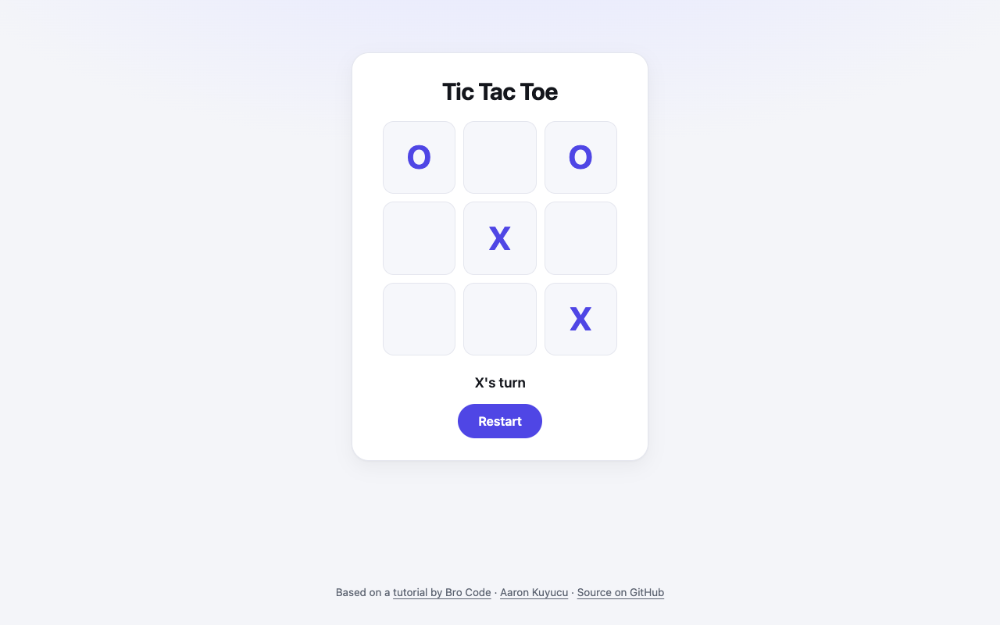

# Tic Tac Toe

The classic two-player game in the browser, with win and draw detection.



## Features

- Two players take turns as X and O
- Detects all eight winning lines and draws
- Status line for whose turn it is, and a restart button
- Playable with the keyboard: Tab or the arrow keys move between cells, Enter or Space places a mark
- For screen readers, each cell has a label with its position and content, and the status line is a live region (not yet tried with a real screen reader)

## Tech

- HTML, CSS, vanilla JavaScript
- The rules (`getWinner`, `isDraw`) are pure functions in `game.js`, separate from the page logic in `index.js`

## How to run

Open the live version: **[aaronkuy.github.io/tic-tac-toe](https://aaronkuy.github.io/tic-tac-toe/)**

Or run it locally. There is no build step and no dependency:

```bash
git clone https://github.com/aaronkuy/tic-tac-toe.git
cd tic-tac-toe
open index.html        # macOS; on Linux use xdg-open, on Windows start
```

## Tests

The rules are tested with Node's built-in test runner, without any package to install
(run locally with Node.js 24 and in CI with the Node.js version on GitHub's Ubuntu runner):

```bash
node --test
```

One of the tests plays all 255,168 possible games and compares the number of X wins, O wins and draws
with the known totals. The page logic in `index.js` has no automated tests.

## What I'd do next

- A computer opponent (minimax)
- Score across rounds
- Highlight the winning line

## Credits

This project started from Bro Code's tutorial
[A game of TicTacToe written in JavaScript](https://www.youtube.com/watch?v=AnmwHjpEhtA):
the game rules, the page structure and the first stylesheet come from there.
Added in this repository: the visual redesign from October 2026, keyboard and screen-reader support,
the rules as separate functions in `game.js`, and their tests.

## License

MIT, see [LICENSE](LICENSE). The license covers what was added in this repository;
the tutorial code it builds on remains Bro Code's.
