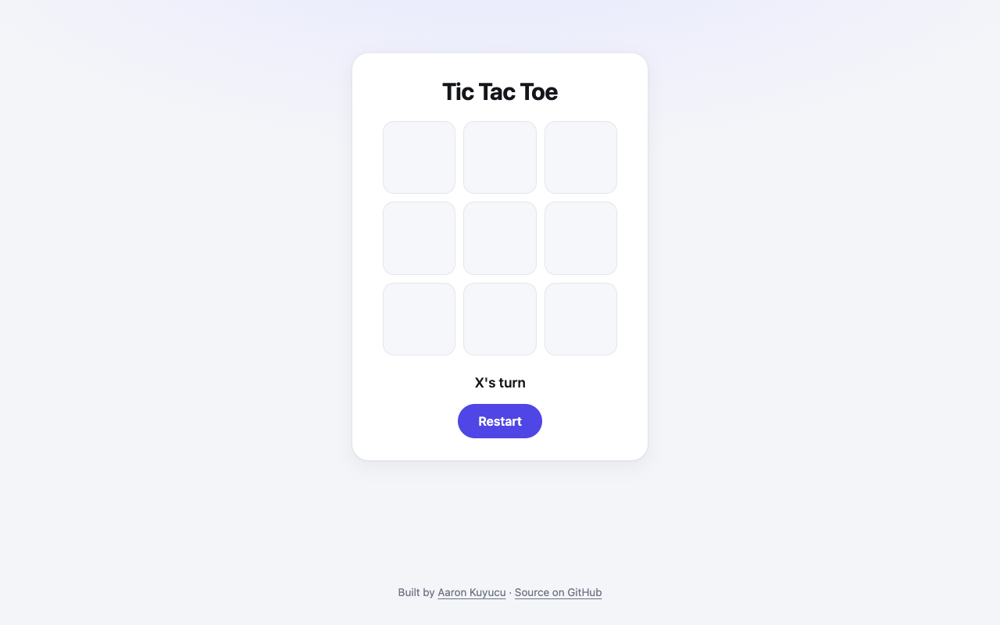

# Tic Tac Toe

The classic two-player game in the browser, with win and draw detection.



## Features

- Two players take turns as X and O
- Detects all eight winning lines and draws
- Status line for whose turn it is, and a restart button

## Tech

- HTML, CSS, vanilla JavaScript

## How to run

Open the live version: **[aaronkuy.github.io/tic-tac-toe](https://aaronkuy.github.io/tic-tac-toe/)**

Or run it locally. There is no build step and no dependency:

```bash
git clone https://github.com/aaronkuy/tic-tac-toe.git
cd tic-tac-toe
open index.html        # macOS; on Linux use xdg-open, on Windows start
```

## What I learned

- Modelling a 3x3 board as a flat array
- Checking win conditions against a list of index triples
- Keeping game state (`running`, `currentPlayer`) consistent

## What I'd do next

- A computer opponent (minimax)
- Score across rounds
- Keyboard and screen-reader support for the board

## License

See [LICENSE](LICENSE).
